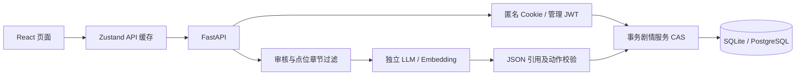

# 总体技术架构 · 实现版

## 数据与控制流

玩家浏览器只缓存快照。数据库保存会话、旅程、任务、物品、图鉴、结局、对话与动作回执。CAS 在事务内先取得一次更新权，再执行校验/奖励/日志；异常全部回滚。内容治理另外使用版本 CAS，编辑撤销审核与旧索引。

## 实现选择

|模块|当前实现|局限|
|---|---|---|
|界面|React18/Vite/TypeScript/Tailwind/Zustand，保留既有视觉|一个主题，无离线权威模式|
|地图|腾讯 GL JS + SVG 无 key 回退|近似坐标未实地核验|
|会话|高熵 token，HMAC hash 存库，HttpOnly Cookie|没有跨设备账号，过期清理待运营|
|业务|FastAPI/SQLAlchemy2/Alembic；SQLite本机实测|PostgreSQL 16.15 容器实测通过（迁移 0002、20 张表）|
|检索|审核版本 SQL chunks，中文双字词关键词、精确余弦混合|小语料全量精确检索，无ANN性能主张|
|生成|DeepSeek/Qwen兼容接口、Ollama、本地Mock|DeepSeek `deepseek-chat` 与通义 `text-embedding-v3` 已真实调用并留证|
|治理|管理Cookie JWT、来源/授权人工确认、发布/撤销、审计|不提供任意节点/答案在线编辑|
|部署|两阶段前端Nginx、非root后端、Postgres pgvector Compose|容器全栈实测通过；TLS终止仍由部署环境配置|

17需求实体对应数据库文档；ActionReceipt 是为可重试动作增加的工程实体。PostgreSQL迁移额外管理 knowledge_vectors，保存带模型/维度约束的向量；当前排序仍由应用执行精确余弦，不声称原生ANN索引。

## 文化与安全边界

种子默认 24 条知识均为 pending、不发布正式 chunks；导入已核对语料后 22 条转为 reviewed 并建立索引，其余 2 条保持排除。四类事实标签不是审核凭证。玩家可完成演示任务与虚构剧情，文化问答在缺证据时拒答。模型输出必须使用当前检索证据ID；不能直接修改剧情。有效引用ID不等于语义事实必然成立，真实模型还需人工事实核验。

同源写操作检查 Origin，数据库不可用和参数错误返回脱敏结构；管理接口认证，输入有长度约束，聊天与管理员登录有进程内限流。生产需要HTTPS以发送Secure Cookie：明文 HTTP 部署必须显式设置 `SESSION_COOKIE_SECURE=false`，否则登录后接口全部 401 而健康检查正常。多实例须共享限流；备份恢复已在隔离库验证。
