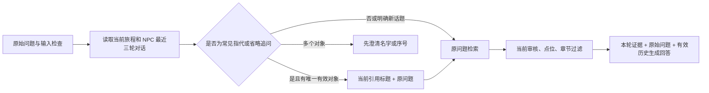

# RAG 与 NPC Agent · 实现与验证边界

## 资料治理与索引

管理端新增资料默认 pending。清洗采用 Unicode NFKC、空白归一化和 SHA256 正文去重；切分450字符，重叠60字符，记录标题、点位、内容类型、来源/URL/授权、标签、最早章节、审核人、版本和指纹。

人工审核必须确认来源 URL 与授权，不能接受“待补充/不明/未授权”等说明。reviewed 且非演示资料才可 publish。编辑和审核变更递增内容版本、撤销旧 chunks；检索连接资料表检查最新审核版本，防止旧向量继续生效。种子默认 24 条 pending、0 条正式检索证据；导入已核对语料后 22 条 reviewed、2 条排除。

SQLite 使用 KnowledgeChunk JSON 向量；PostgreSQL 0002启用 pgvector 并建立 knowledge_vectors 原生向量表。维度、模型名称随每块记录，数据库检查 vector_dims。当前应用做精确余弦排序，无 HNSW、Chroma 或性能索引主张。

## 召回与过滤

1. 读取所属旅程与当前点位，校验NPC在当前点位。
2. 输入注入规则、常见长token/邮箱/手机号保护；风险输入不调用生成或Embedding。
3. SQL仅取reviewed、非demo、当前版本资料，检索进一步过滤当前点位、最早章节、冲突和来源/授权。
4. 中文连续片段的双字词与英数字词做关键词召回；关键词得分为查询词覆盖比例。
5. 有独立Embedding配置时嵌入问题，验证模型及维度，余弦得分≥0.65或关键词≥0.12才成为候选。
6. 混合分数0.65×关键词+0.35×余弦；无向量时仅关键词。正文指纹去重、稳定排序，再按 knowledge_id 去重，最多4条独立知识，每条使用得分最高的块。正式对话、后台和真实评测统一调用 retrieve_knowledge。
7. Embedding暂不可用时降级关键词，并在响应记录原因。阈值是保守工程参数，未校准为文化准确率。
8. 无证据、错误年代前提、冲突、无效引用、JSON错误、危险输出均使用固定拒答。

当前NPC只使用所在点位证据；角色卡知识边界作为提示词上下文，尚无单独人物/时期语义分类器。后续扩展主题时应把更细边界加入数据库过滤。

## 多轮追问与本地查询改写（2026-10-17）

`ai/rag/conversation.py` 借鉴 rag-architect 的 Query Rewriting 思路，采用本地规则补全常见的“它在哪里”“能再详细讲讲吗”“什么时候建的”等追问。只使用最近一轮的引用 ID，重新读取其当前有效标题作为检索主体，不复制旧回答作为证据；生成提示词同时接收原始问题和补全后的问题，并要求直接回应追问、避免整段重复。

- 对象明确时，将标题与完整原问题合并，Embedding 和关键词检索使用同一个补全问题；限定在选中的知识条目内检索。
- 明确点名的新标题、书名或其他路线点位优先按新问题检索，不自动沿用旧主题。多个候选对象时先列出名字和序号；“第二个”“后者”等回复可继续选择，复数追问可保留多个对象。
- 每轮重新校验审核版本、点位、章节、冲突、来源与许可。撤审、转移点位或最近一轮拒答后，不退回更早的话题；候选撤销时也不重新编号猜测序号含义。
- 历史按 `journey_id + npc_id` 隔离，并记录 `context_spot_id`。旧日志仅在引用能确定点位时用于补全；无需数据库迁移。提供给生成模型的历史也排除已失效或跨点位的引用。
- 改写不新增模型请求，不引入新依赖；Embedding 故障沿用已有关键词回退。危险输入在补全及提供方调用前拦截。对话日志仍保存经脱敏的原始问题，响应仅记录 `query_context.mode/knowledge_ids`，不另存原始查询副本。
- 本地澄清返回 `intent=clarification`、`provider=none`、空引用及 `CONTEXT_AMBIGUOUS/CONTEXT_REQUIRED`；前端标为“确认话题”，不冒充有证据的事实回答。

这是面向当前小型语料的保守规则，不是通用中文指代消解器：未覆盖的表达仍可能走原问题检索；多个资料标题也不必然对应多个真实实体。复杂跨主题指代和口语理解需要更全面的题集与人工体验评估，当前不宣称已完成真实模型自然度验收。

回归入口：`pytest tests/test_conversation.py tests/test_rag_pipeline.py tests/test_input_safety.py`。使用临时数据库和合成自有文本，覆盖追问、话题切换、澄清选择、复数对象、会话/NPC/点位隔离、旧日志兼容、撤审/未来章节/冲突/来源过滤、输入拦截、年代前提和 Embedding 故障回退；不调用真实付费模型。

## 生成与动作

角色、玩家、当前剧情、最近3轮对话与证据JSON作为数据；系统提示词声明这些数据不能覆写规则。ModelReply严格校验 dialogue、intent、emotion、evidence_ids、task_action、task_id、clue_id、suggested_next_node、unlock_knowledge、safety_flag，禁止多余字段。输出引用须非空且全部在当前召回集中；内容显示史实/争议/传说/虚构标签。

所有模型建议动作均被拒绝并记 SafetyLog。两个演示线索由独立作者规则发放：平江图提示 → clue-shaoding；苏博片石/白墙提示 → clue-baibi。这只是虚构解谜道具，回复明确标记不代表文化资料已审核。任务答案、物品归属、奖励和结局仍由事务剧情服务决定。

证据ID校验不能证明每句话完全被资料支持，关键词注入检测也不是对所有攻击的保证。本次合成测试只验证指定机制；真实模型的幻觉、角色表达和文化质量需要真实样本、人工复核及对抗测试。

2026-10-17 起，事实正文改用经过核对的原文片段：模型提供 `evidence_quotes[{evidence_id,quote}]`，每段必须属于本轮引用，且是对应原文的完整句子/完整块，保留否定和限定。界面不直接展示模型自由改写的 `dialogue`。无片段的旧格式安全回退至所引原文（`grounding_mode=source_fallback`），有效片段标为 `verified_excerpt`；伪造、半句或越引用片段以 `EVIDENCE_TEXT_INVALID` 拒绝。角色称呼仍由服务端生成。此机制保证展示文字可在本轮资料中找到，不证明资料本身真实，也不代替人工文化评分；不再把引用 ID 有效当作模型事实改写已验收。

## 分开配置生成与 Embedding

`.env.example`列出全部变量。生成选择 LLM_PROVIDER=deepseek/qwen/ollama/mock，并显式设置 LLM_BASE_URL、LLM_MODEL 和对应密钥。远程聊天缺密钥降为 provider=mock、mock=true，并记录 API_KEY_MISSING；正常Mock为审核证据的抽取式表达，不是LLM生成。

Embedding选择 EMBEDDING_PROVIDER=none/openai-compatible/qwen/ollama，单独指定 API_KEY、BASE_URL、MODEL、DIMENSION（默认1024）。none只建立关键词chunks；配置Embedding却不可用时发布失败、事务回滚，不把伪向量冒充索引。同一模型/维度更改后须重新发布所有已审索引。

DeepSeek/Qwen使用 /chat/completions + response_format=json_object；Ollama用 /api/chat format=json。Embedding兼容提供方用 /embeddings，Ollama用 /api/embed。请求有30秒超时，不记录厂商响应体或私钥。HTTP适配器trust_env=false，需代理时应在部署中明确设置网络，而非继承不受控环境代理。

参考官方协议：[DeepSeek对话](https://api-docs.deepseek.com/api/create-chat-completion/)、[JSON模式](https://api-docs.deepseek.com/guides/json_mode/)、[Qwen Embedding](https://www.alibabacloud.com/help/en/model-studio/embedding)、[Ollama chat](https://docs.ollama.com/api/chat)、[Ollama embed](https://docs.ollama.com/api/embed)、[pgvector](https://github.com/pgvector/pgvector)。本次验证HTTP契约使用本地MockTransport，未调用这些服务。

## 证据与测试

聊天返回provider/model/mock/reason、data_scope=reviewed_only、evidence_ids、完整证据与approved_actions；对话、提示词版本、纠错持久化。常见敏感串在日志与纠错中掩码；原始位置不保存。

12类合成评测及执行结果见 data/testsets/ai-cases.json、results.json 与测试报告。可运行 `python scripts/evaluate_ai.py`；`--persist-db` 可将合成评测结果写入TestCase供后台查看。没有真实资料质量、真实LLM/Embedding效果或文化准确率数值。

## 真实实验的无费用预检

现有evaluate_retrieval_arms.py与evaluate_live_ai.py已复用并修复；默认CLI只做preflight/dry plan，程序evaluate默认也拒绝远程调用。黄金集须reviewed并登记真实审核人/日期，知识须已审核发布且不是演示。需要调用时，先核实提供方计价、查看计划请求上界，再取得该次用户明确授权后传--allow-paid-calls。本轮用户选择无费用审查，没有真实调用；未知token估算和成本保留null，实际usage仅取提供方返回值。

三臂固定同一语料、作用域、K、模型及维度，每问题只计算一次query Embedding。指标按knowledge_id计数，按分数去重后取K个独立知识，保留实际chunk ID供追溯。Precision@K分母为配置K，答案型空召回为0且计入均值；precision_of_returned另按实际返回量计算。没有相关证据的拒答案例不混进Recall/Precision均值。混合与向量统计分开记录共享Embedding耗时、检索耗时和实际失败。普通LLM/RAG/证据/剧情约束四组生成消融尚未实验；事实准确性与角色一致性必须人工评分。详细失败→修复记录见[evaluation-tool审查](evaluation-tool-audit-2026-10-10.md)。

## 2026-10-11 真实配置与实测

| 项 | 实际值 |
|---|---|
| Embedding 提供方 / 模型 / 维度 | 通义 `text-embedding-v3` / **1024** |
| 聊天提供方 / 模型 | DeepSeek `deepseek-chat` |
| 提示词版本 | `npc-evidence-v2`（v1 未声明枚举取值，真实模型返回 `emotion="平静"` 被 schema 拒绝） |
| 已审核语料 | 22 条（验收当日为 11 条，其后扩充；另有 2 条 pending 未入库） |
| 索引 | 11 个块，全部带 1024 维向量；pgvector 原生表 11 行且 `vector_dims=1024` |

**导入幂等性**：`build_reviewed_corpus.py --apply` 重复执行不会增长版本，也不会重新调用
Embedding。判定依据是内容签名（含标题、正文、类型、来源、许可、审核状态、审核人、演示标记、
元数据与审核时间）以及索引状态（块是否存在、知识版本是否一致、`embedding_model` 与
`embedding_dimension` 是否与当前配置一致）。嵌入模型或维度变化会触发重建，避免检索继续使用
旧模型向量而阈值仍按新配置判断。`--expect N` 可断言本次变更条数，`--force-reindex` 用于强制重建。

**导入原子性**：行变更与索引重建在同一事务内提交。任一条目失败会整体回滚并在结果中列出
`failures`，脚本以非零退出码结束，不会留下"已审核但索引不完整"的条目。

**实测结果**（真实 Embedding 与真实聊天模型）：

- 三臂检索对照（32 题）：关键词 0.54 / 向量 0.62 / 混合 0.72（Recall@4）。按题面难度分层后，
  关键词臂在改写题上为 0.0417，混合臂为 0.4167，差异才显现。
- 生成消融（四臂）：不接检索时 23 条回答**全部没有引用**；引用校验层实测拦下模型自行产生的
  6 条无效引用；拒答题错误回答数从 6/9 降到 1/9。
- 浏览器端真实链路：可答问题走混合检索并挂出引用，知识库外与注入提问在本地拦截且提供方为
  `none`（零调用）。
